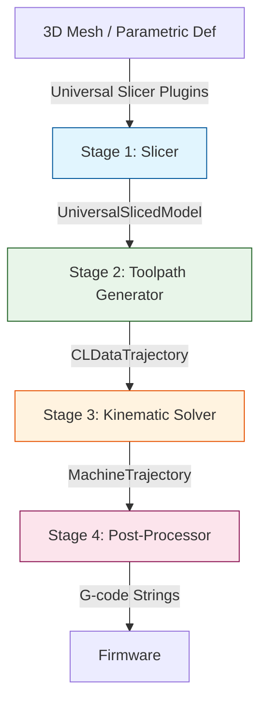

# Modular 5-Axis Additive Manufacturing CAM Architecture

## System Pipeline Diagram

## Data Contracts Registry
All inter-stage data exchanges are strongly typed using Pydantic in `src/common/schemas.py` and serialize to JSON files for standalone execution.

| Contract Schema | Origin -> Destination | Key Fields |
| --- | --- | --- |
| `UniversalSlicedModel` | Stage 1 -> Stage 2 | `layers` (List of `UniversalLayer`: `layer_index`, `z_height`, `z_prime`, `contours`), each contour with `points` (X,Y,Z), `normals` (I,J,K), `thicknesses`, `feature_type`. `metadata` holds the slicing parameters **after default resolution** (`start_z`, `end_z`, `pivot_y`, ...), so Stage 2 rebuilds the strategy identically. |
| `MinimalPrintProfile` | Config -> Stage 2/4 | `layer_height`, `nozzle_diameter`, `continuous_spiral`, `filament_diameter`. |
| `CLDataTrajectory` | Stage 2 -> Stage 3 | `waypoints` (List of `CLDataWaypoint`): `x`, `y`, `z`, `i`, `j`, `k`, `extrusion_volume`, `feedrate`, `is_travel_move`, `feature_type`, `layer_index` (travel moves belong to the layer they travel into). |
| `MachineConfig` | Config -> Stage 3 | `kinematic_topology`, pivot offsets, axis limits, `max_3axis_tilt_deg`. |
| `MachineTrajectory` | Stage 3 -> Stage 4 | `states` (List of `MachineStateVector`): `x`, `y`, `z`, `b`, `c`, `extrusion_volume`, `feedrate`, `is_travel_move`, `feature_type`, `layer_index` (copied 1:1 from the waypoint by every solver). |

## Stage 1 Mathematical Slicing Strategies (`src/stage1_slicer/math_strategies.py`)

*Note: All strategies support adaptive local layer thickness and dynamic mesh bounds.*

| Strategy ID | Description | Parameters |
| --- | --- | --- |
| `planar` | Standard planar slicing ($Z = const$) | `start_z`, `end_z`, `layer_height` |
| `progressive_tilt` | Linearly tilts normal around X axis across layers. | `start_tilt_deg`, `end_tilt_deg` |
| `conical` | Deform-Slice-Undeform for support-free overhangs ($z' = z + r \cdot \tan\alpha$) | `cone_angle_deg` |
| `custom_expr` | Deform-Slice-Undeform of $f(x, y)$. The expression is validated against an AST whitelist (`src/stage1_slicer/safe_expr.py`: names `x`,`y`,`r`,`pi`,`e`, `+ - * /`, `**` with a small literal exponent, a fixed set of `np.`/`math.` functions) and compiled once; anything else raises `ValueError`. | `expression` |
| `external_field` | Point cloud spatial interpolation (pure Numpy IDW) | `vertex_deformations` (array or list; **not** stored in the JSON metadata, Stage 2 rebuilds the field from the layer contours) |

### Strategy interface used by Stage 1 and Stage 2
Strategies are created through `build_strategy(name, mesh, params)`. Stage 1 passes the real mesh, Stage 2 an empty `trimesh.Trimesh()` plus the resolved `metadata`.

| Method | Purpose |
| --- | --- |
| `get_resolved_params()` | Parameters after defaults were resolved from the mesh (`start_z`, `end_z`, `layer_height`, `transition_height`, tilt angles, `pivot_y`, `cone_angle_deg`, `expression`). Written to `UniversalSlicedModel.metadata`. |
| `undeform_point(pt, layer_idx)` | Maps a point of the deformed slice back to part space. Pass-through for `progressive_tilt` (Stage 1 already slices on the real tilted plane). |
| `project_to_layer(x, y, layer_idx)` | Lifts a 2D point generated by Stage 2 onto its layer surface (tilted plane for `progressive_tilt`, `undeform_point` otherwise). |
| `compute_normal`, `compute_thickness` | Local surface normal and layer thickness. |
| `_solve_forward_z` | Solves $z' = z + w(z')\,f$ (transition zone); raises `ValueError` if it does not converge. |

## Stage 2 Toolpath Generator (`src/stage2_toolpath/contour_generator.py`)

`StandardToolpathGenerator.generate_toolpath(model, profile)` never modifies the input model. Public helpers: `analyze_layers()` (2D regions per layer) and `build_layer_features()` (printable contours per layer).

1. **Contour classification.** Closed boundary rings are classified by nesting depth: even depth = outer boundary of a part, odd depth = hole, so an island inside a hole is a part of its own. Open contours (helix / vase mode / parametric paths) are intentional paths and are printed unchanged as `outer_wall`. Closed but invalid rings are skipped with a warning; the raw Stage 1 boundary is never emitted as a perimeter.
2. **Walls.** `num_perimeters` offsets of every part (hole boundaries included).
3. **Skins.** With $R_i$ the infill region of layer $i$ (parts eroded by the walls): bottom skin $= R_i \setminus \bigcap_{k=1}^{n_b} R_{i-k}$, top skin $= R_i \setminus \bigcap_{k=1}^{n_t} R_{i+k}$, sparse $= R_i \setminus (\text{top} \cup \text{bottom})$. Neighbours are looked up by `layer_index` (a missing layer exposes everything), so internal overhangs get a bottom skin. Slivers narrower than one line are dropped. `top_solid_layers` / `bottom_solid_layers` = 0 disables a skin.
4. **Fill.** Rectilinear scanlines per connected polygon (global line lattice). Skins use 100 % density at +-45 deg per layer, sparse infill uses `infill_density` / `infill_angle_deg`. Pieces on adjacent scanlines are joined into one zig-zag **only if the straight link stays inside the region** (buffered by 0.1 x spacing); otherwise a new contour (a real travel) starts.
5. **Order inside a layer** (`FEATURE_ORDER`): `inner_wall` -> `outer_wall` -> `bottom_solid` -> `top_solid` -> `infill`. Closed rings start at the vertex nearest to the current position.

Feature types emitted: `outer_wall`, `inner_wall`, `bottom_solid`, `top_solid`, `infill`.

## Stage 3 Kinematic Solvers (`src/stage3_kinematics/registry.py`)

| Topology ID | Transformation |
| --- | --- |
| `trunnion_table_xyzbc` | $P_m = P_p + R_B(B) \cdot (R_C(C) \cdot P_e - P_p)$ |
| `swivel_head_xyzbc` | $P_m = P + P_p - R_C(C) \cdot R_B(B) \cdot P_p$ |
| `planar_3axis_xyz` | $P_m = P$ (Pass-through). Logs warnings if surface tilt exceeds `max_3axis_tilt_deg`. |

## User Interfaces

| Interface | Command | Description |
| --- | --- | --- |
| **Interactive GUI** | `PyQt6 run src/ui_app.py` | Web-based interface to generate/upload meshes, configure slicing/kinematics parameters, preview 3D layers/toolpaths via Plotly, and download G-code. |
| **CLI Runner** | `python3 src/pipeline_cli.py run-all` | Headless execution of all stages sequentially using JSON configs. |

## Validation & Test Matrix
Execute with `pytest tests/`

| File | Subsystem | Validation |
| --- | --- | --- |
| `test_stage1_math_slicer.py` | Stage 1 Plugin | Validates discrete plugin parameter parsing & default vertical normals. |
| `test_stage1_field_slicer.py` | Stage 1 Engine | Evaluates output structure of mathematical fields. |
| `test_mathematical_validation.py` | Stage 1 & 3 | **Mathematical Exactness**: Validates numerical derivatives against analytical expressions. Validates Kinematic FK/IK Roundtrip error $< 1e-5$. |
| `test_multi_kinematics.py` | Stage 3 Solvers | Tests topology configurations. |
| `test_deformation_independent.py` | Stage 1 math | Independent checks: outward cone normal vs. finite differences, deform/undeform round trip (transition zone), refined box vs. analytic surface. |
| `test_safe_expr.py` | Stage 1 security | AST whitelist: malicious / DoS expressions are rejected, valid ones match a numpy reference. |
| `test_stage12_consistency.py` | Stage 1 -> 2 | Resolved parameters, identical strategy math in both stages, tilted-plane geometry, `external_field` end to end through JSON, solver convergence error. |
| `test_stage2_shells_infill.py` | Stage 2 | Skins, infill linking, holes/islands, hygiene, no mutation, feature order, travel counts, `layer_index` propagation through the solvers. |
| `test_stage4_postproc.py` | Stage 4 Post-proc | Validates volumetric to linear E conversion. |
| `test_visual_cases.py` | E2E CLI | Asserts all JSON and HTML files are generated correctly. |
