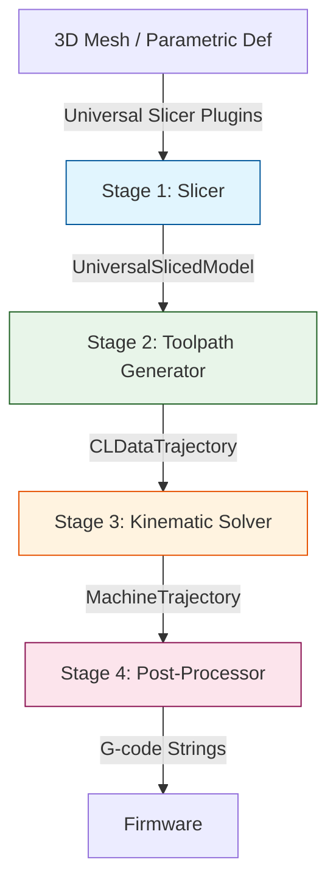

# Modular 5-Axis Additive Manufacturing CAM Architecture

## System Pipeline Diagram

## Data Contracts Registry
All inter-stage data exchanges are strongly typed using Pydantic in `src/common/schemas.py` and serialize to JSON files for standalone execution.

| Contract Schema | Origin -> Destination | Key Fields |
| --- | --- | --- |
| `UniversalSlicedModel` | Stage 1 -> Stage 2 | `layers` (List of `UniversalLayer`: `layer_index`, `z_height`, `z_prime`, `contours`), each contour with `points` (X,Y,Z), `normals` (I,J,K), `thicknesses` and `feature_type` (`boundary` straight from Stage 1). `metadata`: the slicing parameters plus the **resolved** values (`start_z`, `end_z`, `pivot_y`, `transition_height`, ...) written by `strategy.get_resolved_params()`; Stage 2 rebuilds the strategy from exactly these. Large numpy fields (e.g. `vertex_deformations`) are never stored. |
| `MinimalPrintProfile` | Config -> Stage 2/4 | `layer_height`, `nozzle_diameter`, `num_perimeters`, `top_solid_layers`, `bottom_solid_layers` (0 disables the skin), `infill_density` (fraction 0..1), `infill_pattern` (`lines`), `infill_angle_deg`, `max_segment_length`, `continuous_spiral`, `filament_diameter`, speeds (`print_speed`, `travel_speed`, `z_speed`, `retract_speed`), `retract_distance`, `z_hop`, `min_retract_travel`, `travel_command` (`G0`/`G1`). `wall_count` is accepted as an alias of `num_perimeters`. |
| `CLDataTrajectory` | Stage 2 -> Stage 3 | `waypoints` (List of `CLDataWaypoint`): `x`, `y`, `z`, `i`, `j`, `k`, `extrusion_volume`, `feedrate`, `is_travel_move`, `feature_type`, `layer_index` (the layer a waypoint belongs to; a travel move belongs to the layer it travels INTO). |
| `MachineConfig` | Config -> Stage 3 | `kinematic_topology`, pivot offsets, axis limits, `max_3axis_tilt_deg`. |
| `MachineTrajectory` | Stage 3 -> Stage 4 | `states` (List of `MachineStateVector`): `x`, `y`, `z`, `b`, `c`, `extrusion_volume`, `feedrate`, `is_travel_move`, `feature_type`, `layer_index` (copied unchanged from the waypoint, so a state keeps its layer in machine space). |

## Stage 1 Mathematical Slicing Strategies (`src/stage1_slicer/math_strategies.py`)

*Note: All strategies support adaptive local layer thickness and dynamic mesh bounds.*

| Strategy ID | Description | Parameters |
| --- | --- | --- |
| `planar` | Standard planar slicing ($Z = const$) | `start_z`, `end_z`, `layer_height` |
| `progressive_tilt` | Linearly tilts normal around X axis across layers. | `start_tilt_deg`, `end_tilt_deg` |
| `conical` | Deform-Slice-Undeform for support-free overhangs ($z' = z + r \cdot \tan\alpha$) | `cone_angle_deg` |
| `custom_expr` | Deform-Slice-Undeform of $f(x, y)$. The expression is validated against an AST whitelist (`src/stage1_slicer/safe_expr.py`), never evaluated blindly. | `expression` |
| `external_field` | Point cloud spatial interpolation (pure Numpy IDW) | `vertex_deformations` array or list (not stored in the JSON metadata; Stage 2 rebuilds the field from the layer contours) |

Every strategy implements the same interface used by Stage 1 **and** Stage 2 (`build_strategy(name, mesh, params)` is the single factory; Stage 2 passes an empty mesh and the resolved metadata):

| Method | Purpose |
| --- | --- |
| `get_resolved_params()` | Copy of the parameters after defaults were resolved (mesh-derived `start_z`, `end_z`, `pivot_y`, ...). Stored in the Stage 1 metadata. |
| `project_to_layer(x, y, layer_idx)` | Lifts a 2D point of a layer to its true 3D position. Planar/deforming strategies use `undeform_point` at `z' = start_z + idx*h`; `progressive_tilt` returns the point on the tilted plane `z = z0 + (y - pivot_y) tan(t)`. |
| `compute_normal`, `compute_thickness` | Normal and local layer thickness at a 3D point. |
| `_solve_forward_z(z, f)` | Solves `z' = z + w(z') f` (fixed point); raises `ValueError` with the residual if it does not converge. |

## Stage 2 Toolpath Generation (`src/stage2_toolpath/contour_generator.py`)

`StandardToolpathGenerator.generate_toolpath(model, profile)` never modifies the model. Steps:

1. **Outlines**: closed contours become shapely polygons; nesting-depth parity decides hole (odd) vs. outer boundary / island (even). Open, self-intersecting or degenerate contours are skipped with a warning (the raw `boundary` contour is never emitted).
2. **Walls and infill region**: `num_perimeters` walls offset by `nozzle_diameter`; the infill region is the outline eroded by all walls.
3. **Skin**: layers are compared **by `layer_index`** (missing neighbour = exposed). `bottom_solid` = region minus the intersection of the `bottom_solid_layers` regions below, `top_solid` = region minus the intersection of the `top_solid_layers` regions above, `infill` (sparse) = the rest. Solid skin uses 100 % density at +-45 deg alternating per layer.
4. **Fill**: scanlines per connected polygon, joined into zigzag chains only when the straight link stays inside `region.buffer(0.1 * spacing)`; otherwise a new chain starts (a real travel).
5. **Trajectory**: 2D points are projected with `strategy.project_to_layer`; travel moves are inserted between non-adjacent contours.

| `feature_type` | Meaning |
| --- | --- |
| `inner_wall`, `outer_wall` | Wall rings, printed per outline from the innermost wall to the outer wall |
| `bottom_solid`, `top_solid` | Solid skin |
| `infill` | Sparse infill |

Print order inside a layer is `FEATURE_ORDER = (inner_wall, outer_wall, bottom_solid, top_solid, infill)`.
`generate_features(model, profile)` returns the per-layer feature contours, `compute_layer_regions(model, profile)` the shapely regions (for tests and previews).

## Stage 3 Kinematic Solvers (`src/stage3_kinematics/registry.py`)

| Topology ID | Transformation |
| --- | --- |
| `trunnion_table_xyzbc` | $P_m = P_p + R_B(B) \cdot (R_C(C) \cdot P_e - P_p)$ |
| `swivel_head_xyzbc` | $P_m = P + P_p - R_C(C) \cdot R_B(B) \cdot P_p$ |
| `planar_3axis_xyz` | $P_m = P$ (Pass-through). Logs warnings if surface tilt exceeds `max_3axis_tilt_deg`. |

## User Interfaces

| Interface | Command | Description |
| --- | --- | --- |
| **Interactive GUI** | `python3 src/gui_app.py` | Native PyQt6 + pyqtgraph desktop application to generate/upload meshes, configure slicing/kinematics parameters, preview 3D layers/toolpaths and export G-code. Skin layers (top/bottom), travel command, retract and Z-hop are editable; the view checkboxes double as the colour legend (`src/common/feature_styles.py` is the single source of line-type colours: outer wall green, inner wall yellow, bottom skin orange, top skin magenta, sparse infill blue, travel red). |
| **CLI Runner** | `python3 src/pipeline_cli.py run-all` | Headless execution of all stages sequentially using JSON configs. |

## Validation & Test Matrix
Execute with `pytest tests/`

| File | Subsystem | Validation |
| --- | --- | --- |
| `test_stage1_math_slicer.py` | Stage 1 Plugin | Validates discrete plugin parameter parsing & default vertical normals. |
| `test_stage1_field_slicer.py` | Stage 1 Engine | Evaluates output structure of mathematical fields. |
| `test_mathematical_validation.py` | Stage 1 & 3 | **Mathematical Exactness**: Validates numerical derivatives against analytical expressions. Validates Kinematic FK/IK Roundtrip error $< 1e-5$. |
| `test_multi_kinematics.py` | Stage 3 Solvers | Tests topology configurations. |
| `test_stage4_postproc.py` | Stage 4 Post-proc | Parses the G-code (`tests/gcode_tools.py`): E = volume/area, retract -> Z-hop -> travel -> Z-hop -> prime sequence, short travels direct, G0/G1 selection, no start heaters, `;LAYER:n` / `; TYPE:` markers, `split_gcode_by_layer`, profile validation. |
| `test_feature_styles.py` | GUI line types | Distinct colour per line type, every Stage 2 feature has a style, grouping honours visibility and `layer_index`; offscreen GUI smoke test (skipped without PyQt6). |
| `test_deformation_independent.py` | Stage 1 math | Independent checks: outward cone normal vs. finite differences, deform -> undeform round trip, refinement vs. the analytic surface. |
| `test_safe_expr.py` | Stage 1 security | AST whitelist: malicious / DoS expressions are rejected, valid ones match a numpy reference. |
| `test_stage12_consistency.py` | Stage 1 -> 2 | Resolved metadata, identical Stage 1 / Stage 2 strategy results per layer, tilted-plane z, `external_field` end to end (Stage 1 -> JSON -> Stage 2). |
| `test_stage2_toolpath.py` | Stage 2 | Top/bottom skin, zigzag linking, holes and islands, immutability, travel counts, `layer_index` through Stage 3. |
| `test_visual_cases.py` | E2E CLI | Asserts all JSON and HTML files are generated correctly. |

## Stage 4 output conventions
* Relative extrusion (M83), absolute positioning; no heater commands at the start (the end block still turns heaters off).
* `;LAYER_COUNT:N` in the header, `;LAYER:n` before the first move of each layer, `; TYPE: <feature>` per layer/feature change.
* Every travel >= `min_retract_travel`: retract, Z-hop up (above the higher of both ends), travel, Z-hop down, prime. Travel/hop moves use `travel_command` (G0 or G1). The first move lifts without retracting.
