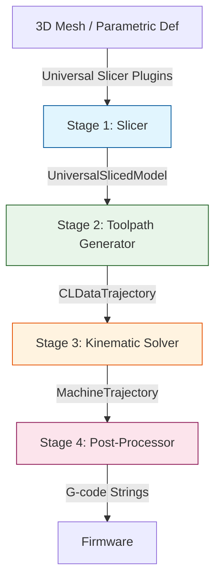

# Modular 5-Axis Additive Manufacturing CAM Architecture

## System Pipeline Diagram

## Data Contracts Registry
All inter-stage data exchanges are strongly typed using Pydantic in `src/common/schemas.py` and serialize to JSON files for standalone execution.

| Contract Schema | Origin -> Destination | Key Fields |
| --- | --- | --- |
| `UniversalSlicedModel` | Stage 1 -> Stage 2 | `layers` (List of `UniversalLayer`: `layer_index`, `z_height`, `z_prime`, `contours`), each contour with `points` (X,Y,Z), `normals` (I,J,K), `thicknesses` and `feature_type` (`boundary` straight from Stage 1). `metadata`: the slicing parameters plus the **resolved** values (`start_z`, `end_z`, `pivot_y`, `transition_height`, ...) written by `strategy.get_resolved_params()`; Stage 2 rebuilds the strategy from exactly these. Large numpy fields (e.g. `vertex_deformations`) are never stored. |
| `MinimalPrintProfile` | Config -> Stage 2/4 | `layer_height`, `nozzle_diameter`, `num_perimeters`, `top_solid_layers`, `bottom_solid_layers` (0 disables the skin), `infill_density` (fraction 0..1), `infill_pattern` (`lines`), `infill_angle_deg`, `max_segment_length`, `continuous_spiral`, `filament_diameter`, speeds (`print_speed`, `travel_speed`, `z_speed`, `retract_speed`, `unretract_speed`), `park_lift`, `infill_overlap`, `thickness_model` (`stage1` | `nozzle_axis`), `retract_distance`, `unretract_distance` (retraction before a travel and the prime right before printing resumes are separate; both default to the retract values), `z_hop`, `min_retract_travel`, `travel_command` (`G0`/`G1`), `hop_short_travels` (Z-hop also on travels below `min_retract_travel`, never with retract). `wall_count` is accepted as an alias of `num_perimeters`. |
| `CLDataTrajectory` | Stage 2 -> Stage 3 | `waypoints` (List of `CLDataWaypoint`): `x`, `y`, `z`, `i`, `j`, `k`, `extrusion_volume`, `feedrate`, `is_travel_move`, `feature_type`, `layer_index` (the layer a waypoint belongs to; a travel move belongs to the layer it travels INTO). |
| `MachineConfig` | Config -> Stage 3 | `kinematic_topology`, pivot offsets, axis limits, `max_3axis_tilt_deg`. |
| `MachineTrajectory` | Stage 3 -> Stage 4 | `states` (List of `MachineStateVector`): `x`, `y`, `z`, `b`, `c`, `extrusion_volume`, `feedrate`, `is_travel_move`, `feature_type`, `layer_index` (copied unchanged from the waypoint, so a state keeps its layer in machine space). |

## Stage 1 Mathematical Slicing Strategies (`src/stage1_slicer/math_strategies.py`)

*Note: All strategies support adaptive local layer thickness and dynamic mesh bounds.*

| Strategy ID | Description | Parameters |
| --- | --- | --- |
| `planar` | Standard planar slicing ($Z = const$) | `start_z`, `end_z`, `layer_height` |
| `progressive_tilt` | Linearly tilts normal around X axis across layers. | `start_tilt_deg`, `end_tilt_deg` |
| `conical` | Deform-Slice-Undeform for support-free overhangs ($z' = z + r \cdot \tan\alpha$) | `cone_angle_deg` |
| `custom_expr` | Deform-Slice-Undeform of $f(x, y)$. The expression is validated against an AST whitelist (`src/stage1_slicer/safe_expr.py`), never evaluated blindly. | `expression` |
| `grid_field` | Same deform-slice-undeform as `custom_expr`, but f(x, y) is a regular grid (imported from a data file, bilinear interpolation, clamped outside). All parameters are plain lists, so they travel through the JSON metadata to Stage 2. | `grid_x`, `grid_y`, `grid_values` (`len(grid_y)` rows of `len(grid_x)` values) |
| `external_field` | Point cloud spatial interpolation (pure Numpy IDW) | `vertex_deformations` array or list (not stored in the JSON metadata; Stage 2 rebuilds the field from the layer contours) |

Every strategy implements the same interface used by Stage 1 **and** Stage 2 (`build_strategy(name, mesh, params)` is the single factory; Stage 2 passes an empty mesh and the resolved metadata):

| Method | Purpose |
| --- | --- |
| `get_resolved_params()` | Copy of the parameters after defaults were resolved (mesh-derived `start_z`, `end_z`, `pivot_y`, ...). Stored in the Stage 1 metadata. |
| `project_to_layer(x, y, layer_idx)` | Lifts a 2D point of a layer to its true 3D position. Planar/deforming strategies use `undeform_point` at `z' = start_z + idx*h`; `progressive_tilt` returns the point on the tilted plane `z = z0 + (y - pivot_y) tan(t)`. |
| `compute_normal`, `compute_thickness` | Normal and local layer thickness at a 3D point. |
| `_solve_forward_z(z, f)` | Solves `z' = z + w(z') f` (fixed point); raises `ValueError` with the residual if it does not converge. |

## Function files and machine files (`config/functions`, `config/machines`)
Both are JSON (`format` + `version` + `name`), validated strictly (unknown fields, missing parameters, out-of-range values are errors that name the element). Parameters are declared as `"name": {"label", "unit", "default" (mandatory), "min", "max", "step", "type": number|int|bool|choice}` (`src/common/param_spec.py`); the GUI builds one named input field per declared parameter and can save the current values back as new defaults.
* **Function file** (`src/stage1_slicer/function_file.py`): `type` is `planar`, `progressive_tilt` (needs `start_tilt_deg`, `end_tilt_deg`; optional `pivot_y`), `conical` (needs `cone_angle_deg`), `expression` (`"expression": "a * np.sin(x / b)"` - every name used must be declared in `parameters`) or `grid` (`"data_file"` relative to the file). Nothing is predefined: a parameter that a type needs but the file does not declare is an error. Shipped: `planar.json`, `progressive_tilt.json` (the template); `examples/wave.json` shows an expression function.
* **Machine file** (`src/stage3_kinematics/machine_file.py`): `kinematics` (registered solver), `axes` (only these appear in the G-code; X Y Z, plus B and C for rotary machines), optional `build_volume`, `parameters` (MachineConfig fields; a rotary machine must declare the B/C limits). Shipped: a generic 3-axis Cartesian machine and a basic 5-axis trunnion table (placeholder values).
* **Editors with preview** (`src/gui_editors.py`, Edit... / New... buttons in the Function and Machine sections): a Form tab and a raw JSON tab describe the same document; every change is validated with the real loaders (`FunctionSpec.from_dict` / `MachineSpec.from_dict`), the first error is shown and Apply / Save as are disabled until the file is valid. Function preview = height map of the last layer over an editable x/y area (`src/stage1_slicer/function_preview.py`, Qt-free); machine preview = XZ side view of the build volume with the nozzle direction at the B limits plus a probe that runs the real solver for a given surface tilt/direction (`src/stage3_kinematics/machine_preview.py`, Qt-free). Apply adds the spec to the session combo box; Save as writes the JSON.

## Stage 0 Function Import & Placement
* `src/stage1_slicer/function_import.py` - user deformation functions f(x, y). **Coordinate reference:** x, y are the coordinates of the part *as placed on the bed* (after the placement step); layers follow `z = z0 - w(z)*f(x, y)` (w = transition blend), so a positive f lowers the layer surface.
  * A. expression file (`.txt`: one expression, `#` / `//` comment lines ignored, lines joined; `.json`: `{"expression": "..."}`), validated by the AST whitelist at load time.
  * B. data file (`x, y, f` columns, CSV / whitespace / `;`, optional header): a complete regular grid is used as is, scattered points are resampled to a regular grid with pure-numpy IDW. Result: `GridField` -> `grid_field` strategy. `preview_surface` samples either kind of field for the Stage 0 preview.
* `src/common/placement.py` - `place_mesh`: rotate about the bounding-box centre (X, Y, Z order), centre in XY, offset X/Y, then either drop to z = 0 or (drop off) move by `offset_z`. Returns a copy.
* `src/common/view_model.py` - Qt-free view logic: layer range (`effective_layers`, `move_range`) and the `Playback` state machine; `feature_styles.group_lines_by_feature` supports `layer_min` and `move_limit`.

## Stage 2 Toolpath Generation (`src/stage2_toolpath/contour_generator.py`)

`StandardToolpathGenerator.generate_toolpath(model, profile)` never modifies the model. Steps:

1. **Outlines**: closed contours become shapely polygons; nesting-depth parity decides hole (odd) vs. outer boundary / island (even). Open, self-intersecting or degenerate contours are skipped with a warning (the raw `boundary` contour is never emitted).
2. **Walls and infill region**: `num_perimeters` walls offset by `nozzle_diameter`; the infill region is the outline eroded by all walls.
3. **Skin**: layers are compared **by `layer_index`** (missing neighbour = exposed). `bottom_solid` = region minus the intersection of the `bottom_solid_layers` regions below, `top_solid` = region minus the intersection of the `top_solid_layers` regions above, `infill` (sparse) = the rest. Solid skin uses 100 % density at +-45 deg alternating per layer.
4. **Fill**: scanlines per connected polygon, joined into zigzag chains only when the straight link stays inside `region.buffer(0.1 * spacing)`; otherwise a new chain starts (a real travel).
5. **Trajectory**: 2D points are projected with `strategy.project_to_layer`; travel moves are inserted between non-adjacent contours.

| `feature_type` | Meaning |
| --- | --- |
| `inner_wall`, `outer_wall` | Wall rings, printed per outline from the innermost wall to the outer wall |
| `bottom_solid`, `top_solid` | Solid skin |
| `infill` | Sparse infill |

Print order inside a layer is `FEATURE_ORDER = (inner_wall, outer_wall, bottom_solid, top_solid, infill)`.
`generate_features(model, profile)` returns the per-layer feature contours, `compute_layer_regions(model, profile)` the shapely regions (for tests and previews).

## Stage 3 Kinematic Solvers (`src/stage3_kinematics/registry.py`)

| Topology ID | Transformation |
| --- | --- |
| `trunnion_table_xyzbc` | $P_m = P_p + R_B(B) \cdot (R_C(C) \cdot P_e - P_p)$ |
| `swivel_head_xyzbc` | $P_m = P + P_p - R_C(C) \cdot R_B(B) \cdot P_p$ |
| `planar_3axis_xyz` | $P_m = P$ (Pass-through). Logs warnings if surface tilt exceeds `max_3axis_tilt_deg`. |

## User Interfaces

| Interface | Command | Description |
| --- | --- | --- |
| **Interactive GUI** | `python3 src/gui_app.py` | Native PyQt6 + pyqtgraph desktop application to generate/upload meshes, configure slicing/kinematics parameters, preview 3D layers/toolpaths and export G-code. The settings column is a scroll area with collapsible sections. Part placement (rotate / centre / offset / drop to bed), layer range sliders, playback (play/pause, speed, scrub; nozzle marker), Stage 0 function import with a surface preview and a Stage 2/3 status line (layer, feature, X Y Z, B C) are available. Skin layers (top/bottom), travel command, retract and Z-hop are editable; the view checkboxes double as the colour legend (`src/common/feature_styles.py` is the single source of line-type colours: outer wall green, inner wall yellow, bottom skin orange, top skin magenta, sparse infill blue, travel red). |
| **CLI Runner** | `python3 src/pipeline_cli.py run-all` | Headless execution of all stages sequentially using JSON configs. |

## Validation & Test Matrix
Execute with `pytest tests/`

| File | Subsystem | Validation |
| --- | --- | --- |
| `test_stage1_math_slicer.py` | Stage 1 Plugin | Validates discrete plugin parameter parsing & default vertical normals. |
| `test_stage1_field_slicer.py` | Stage 1 Engine | Evaluates output structure of mathematical fields. |
| `test_mathematical_validation.py` | Stage 1 & 3 | **Mathematical Exactness**: Validates numerical derivatives against analytical expressions. Validates Kinematic FK/IK Roundtrip error $< 1e-5$. |
| `test_multi_kinematics.py` | Stage 3 Solvers | Tests topology configurations. |
| `test_stage4_postproc.py` | Stage 4 Post-proc | Parses the G-code (`tests/gcode_tools.py`): E = volume/area, retract -> Z-hop -> travel -> Z-hop -> prime sequence, short travels direct, G0/G1 selection, no start heaters, `;LAYER:n` / `; TYPE:` markers, `split_gcode_by_layer`, profile validation. |
| `test_feature_styles.py` | GUI line types | Distinct colour per line type, every Stage 2 feature has a style, grouping honours visibility and `layer_index`; offscreen GUI smoke test (skipped without PyQt6). |
| `test_deformation_independent.py` | Stage 1 math | Independent checks: outward cone normal vs. finite differences, deform -> undeform round trip, refinement vs. the analytic surface. |
| `test_safe_expr.py` | Stage 1 security | AST whitelist: malicious / DoS expressions are rejected, valid ones match a numpy reference. |
| `test_stage12_consistency.py` | Stage 1 -> 2 | Resolved metadata, identical Stage 1 / Stage 2 strategy results per layer, tilted-plane z, `external_field` end to end (Stage 1 -> JSON -> Stage 2). |
| `test_stage2_toolpath.py` | Stage 2 | Top/bottom skin, zigzag linking, holes and islands, immutability, travel counts, `layer_index` through Stage 3. |
| `test_visual_cases.py` | E2E CLI | Asserts all JSON and HTML files are generated correctly. |
| `test_function_machine_files.py` | JSON files | ParamSpec rules, strict function/machine file validation, shipped templates, round trips, `expression_params` end to end, per-state `tool_alignment` of all solvers. |
| `test_first_layer.py` | Layer convention | First layer at one layer height above the bed (never z = 0), last layer at the top, `start_z` = base of the print, every strategy's first layer flat. |
| `test_phase5_models.py` | Phase 5 logic | Placement (incl. Z offset), layer range, playback state machine, grouping by range. |
| `test_function_import.py` | Stage 0 import | Expression/data file parsing and rejection of unsafe input, GridField interpolation, `grid_field` equals the equivalent expression end to end, JSON-safe metadata. |
| `test_gui_smoke.py` | GUI | Offscreen: placement (Z offset only without drop-to-bed) invalidates results, camera framing, mouse wheel never edits a parameter, planar G-code has no B/C, separate retract/unretract, layer range / playback / status, function import (skipped without PyQt6). |
| `test_file_previews.py` | Previews | Height map per function type, machine outline and solver probe (Qt-free). |
| `test_editors.py` | GUI editors | Offscreen: form <-> JSON sync, validation errors block Apply, Apply/Save as, Edit/New buttons add to the combos. |

## Layer convention (Stage 1)
Layer `i` is printed at `z' = start_z + (i + 1) * h` where the parameter `start_z` is the base of the print (default: the lowest point of the mesh) - the first layer therefore sits one layer height above the bed, never at z = 0. Its contours are cut from the mid-plane of the layer (`z' - h/2`), so a slice never coincides with a top or bottom face. `UniversalLayer.z_height` is that mid-plane height; the printed Z comes from `project_to_layer`. The deformation blend `w` starts at the first layer (flat first layer).

## Stage 4 output conventions
* End block: lift `park_lift` mm above the highest point (no fixed Z); `B0 C0` follows only on rotary machines. `thickness_model='nozzle_axis'` scales E by 1/cos(nozzle axis vs layer normal) using `MachineStateVector.tool_alignment`.
* Relative extrusion (M83), absolute positioning; no heater commands at the start (the end block still turns heaters off).
* `;LAYER_COUNT:N` in the header, `;LAYER:n` before the first move of each layer, `; TYPE: <feature>` per layer/feature change.
* Every travel >= `min_retract_travel`: retract, Z-hop up (above the higher of both ends), travel, Z-hop down, prime. Travel/hop moves use `travel_command` (G0 or G1). The first move lifts without retracting.
